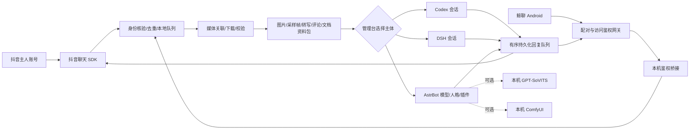

# 肥鱼助手 · Feiyu Assistant

把抖音私信和自制 Android「鲸聊」接入同一套本地 AI 工作流：收信、文件下载、看图、视频采样与音频转写、交给指定智能体处理，再回到原来的通道和设备。提供 Windows 管理台、手机管理入口、语音和本地生图适配。

**版本：v0.2.0（2026-10-26 源码快照）；Android：1.5.2。**

本版同步三主体统一协议4、按来源连续15秒静默合并消息、AstrBot本地素材阅读工具、主会话评论草稿与私信完成联动、HEIC/HEIF解码和256MB视频/实况原片支持。完整变更见 [发布说明](RELEASE_NOTES.md)。

这是一套从实际使用环境整理的 Windows 部署方案，不是抖音官方 SDK，也不是开箱即用的托管服务。发布版提供可配置源码、安装辅助脚本、Android 完整源码与 APK；不包含他人的模型 API 额度、账号登录、聊天数据或数十 GB 模型。先跑通基本收发，再启用可选模块。

## 能做什么

| 模块 | 当前行为 |
|---|---|
| 抖音收发 | 基于 douyin-im 的本地 SDK，核验主人/小号身份、消息去重、原通道回复 |
| 鲸聊 App | 独立于 DSH 的手机收发；Tailscale 连接、扫码配对、远程查看管理台 |
| 智能体选择 | 管理台切换 Codex、DSH、AstrBot；不自动把离线任务改投其他主体 |
| 图片与文件 | 手机＋按钮上传，图片/文档入资料包；单批6个、图片10MiB、其他32MiB |
| 作品解析 | DouK 下载视频、图集和实况；实际文件校验；抽帧、评论、SenseVoice 转写 |
| 语音聊天 | 接收语音转文字；鲸聊可收到 GPT-SoVITS 真音频，并展开合成原文 |
| 本地生图 | ComfyUI + Qwen 插件；可批量生成；无需生图 API Key，但须下载模型 |
| 公开评论 | 可选、默认关闭；独立主站登录；简短评价及可选真实主人提及 |
| 自主活动 | 可选、默认关闭；时段随机浏览/私信分享，以及智能体判断是否主动联系 |
| 管理与清理 | 工作流模块监测、任务/发送状态、资源路径和定期清理 |

抖音原生语音外发仍未实现；不要把鲸聊语音功能误认为抖音语音。视频通过采样画面和自动转写分析，不等于模型逐帧看过完整原视频。未知文件类型只保存，不假装已读懂。

## 架构

详细时序、模块职责和失败处理见 [架构与流程](docs/ARCHITECTURE.md)。

## 从哪里开始

1. 阅读 [部署教程](docs/DEPLOYMENT.md)，安装 Windows、Python、Node.js 和所选 AI 客户端。
2. 复制 `deployment.example.json` 为 **不提交 Git 的** `deployment.local.json`，填自己的主人 UID、小号 UID、主人 sec_uid 路径、运行目录和 Codex 工作区。
3. 执行 `python configure.py`。它把模板编译为运行目录下的 `installed/0.2.0`，不启动服务，不替换本机已有工作流。
4. 安装核心 Python 依赖和 SDK；配置至少一个 AI 主体；再启动生成目录内的 `管理界面.vbs`。
5. 按 [人工配置清单](docs/CREDENTIALS_AND_LOGINS.md) 完成模型 Key、扫码登录、Cookie 或手机配对。
6. 逐项做 [验收与排错](docs/TESTING.md)，再启用公开评论、自主活动等外发功能。

**不要直接双击源码模板中的启动入口。** 带 `__RUNTIME_ROOT__` 等占位符的代码需要先配置。运行数据与源码分离，之后从生成目录运行。

## 哪些东西需要自己准备

- AstrBot 路线：一个自己的模型服务 API Key、Base URL、准确模型 ID，以及单独生成的 AstrBot 本地 API Key。
- Codex/DSH 路线：安装并登录相应客户端，选定可用会话；其账号订阅不自动变成 AstrBot 的 API 额度。
- 抖音：自己的主人账号和助手小号。SDK 扫码、DouK Cookie、公开评论浏览器登录是不同登录态，不能相互替代。
- 鲸聊：安装 APK、Tailscale 网络、二维码配对；新部署生成自己的桥接密钥。
- ASR/TTS/生图：下载相应本地模型；模型许可独立于代码许可。

完整表格与精确保存位置见 [人工配置清单](docs/CREDENTIALS_AND_LOGINS.md)。

## 源码与版本包

- `app/`：本地任务、媒体、队列、管理台、模型服务适配。
- `sdk_*.mjs`：抖音 SDK 服务、事件标准化与分享卡。
- `integrations/whale_gateway/`：独立鲸聊服务和聊天页面。
- `android/`：完整 Android 工程；APK 作为 Release 附件发布。
- `dsh_bridge/`：DSH 宿主内的会话连接器。
- `integrations/astrbot_*`：本项目插件；`third_party/`：单独许可的修改版依赖。
- `deploy/`：依赖安装、连接、模型来源清单。
- `test_*`：隔离回归测试。

Release 的源码 ZIP 与 Git tag 对应；APK 沿用本项目原开发签名，不附私钥。自行构建会使用自己的开发签名，无法覆盖安装签名不同的旧 APK。

## 当前边界

Windows 11 是实际运行环境；Linux/macOS 未完成适配。Codex 和 DSH 会话接口、AstrBot WebChat/插件以及抖音网页结构升级后都可能需要兼容修复。平台接受回执不保证接收者看到；结果不明不会自动重发。首次部署和模型下载仍有人工步骤，没有“复制 Key 就全自动部署”的承诺。

原使用环境已验证收发、媒体、语音、生图和手机交互；本次公开版会额外做配置生成及隔离测试。**没有用一个全新抖音账号完成所有外部服务的从零验收**，不要把本机已有登录态的验收当作每台新机器都已经验收。

原创代码采用 [MIT](LICENSE)，第三方代码、插件和模型的范围见 [来源与许可](THIRD_PARTY_NOTICES.md)。
