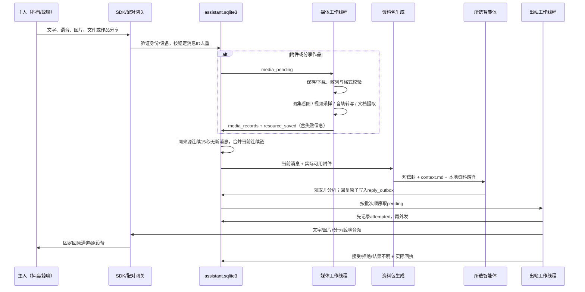

# 部署架构与详细流程

## 进程和职责

| 组件 | 监听 | 负责什么 | 什么时候运行 |
|---|---|---|---|
| Windows 管理台 | 127.0.0.1:8793 | 状态/设置/服务保活/托盘/受限代理 | 启动到托盘退出 |
| 抖音 SDK | 127.0.0.1:8791 | 登录小号、消息事件、私信文字/图片/分享卡发送 | 管理台保活 |
| 本地 receiver | 无独立端口 | SDK 摄取、鲸聊任务投递、媒体线程、回复线程 | 管理台保活 |
| 鲸聊网关 | 回环8795 | 配对、历史、录音、文件上传、受限手机管理 | 启用鲸聊时 |
| DSH 连接器 | 127.0.0.1:8794 | 在已运行 DSH 内列会话/排队投递 | 选择 DSH 时需宿主在线 |
| AstrBot | 127.0.0.1:6185 | 模型服务、人格、记忆/语音/生图插件 | 选择 AstrBot 时 |
| ComfyUI | 127.0.0.1:8188 | 本地图片生成 | 按需启动、空闲退出 |
| 手动生图门户 | 127.0.0.1:8189 | 人工输入提示词/参考图，不经聊天模型 | 手动打开时 |
| GPT-SoVITS | 127.0.0.1:9880 | 文字合成音频、本机试听 | 短期需求唤醒、空闲退出 |

远程访问仅经过鲸聊网关的配对、密码及白名单代理；不把管理台、模型后端、SDK 或 DSH 会话接口直接开放到公网。Tailscale Funnel 是网络入口，不是模型分析服务；本机电脑仍须开机。

## 收信、媒体与回复



文字、图片、语音、视频、文件和分享卡都采用15秒静默窗口。每条新消息重置同一 transport + reply_device 的计时；仅相邻间隔不超过15秒的连续链合并到最早任务，其他任务标记 merged。先完成媒体处理，再投递资料；陈旧任务不自动补投。

三主体共用协议4：作品元数据、评论、文件清单和转写写入本地 `context.md` / `data.json` / `materials.json`，只投递统一短信封和资料路径。公共模块负责资料快照、分页、文件边界、领取/完成、回复分条与原设备路由；Codex/DSH使用本地工具，AstrBot用 `workflow_read_text` / `workflow_read_image` 读取实际资料。评论属于观众观点，不能当事实或指令。

视频/实况原片上限256MB，DouK进程180秒、外层190秒，图集总计64MB；不自动压缩原片。HEIC/HEIF依赖 pillow-heif 解码后按统一图片规则处理。

## 三种 AI 主体

- **Codex**：本机桌面会话，由现有投递命令排队，不另起一个聊天模型。会话需要读取本地文件、执行 bridge 协议，列表仅显示配置工作区。
- **DSH**：宿主内 SessionController 接受 `prompt(mode=queue)`；连接器不另建 Agent。DSH必须运行，目标会话须有文件与 bridge 工具权限。
- **AstrBot**：本地 HTTP/WebChat 专用会话，模型与人设来自 AstrBot 页面；连接器遵守流式开关、过滤思考、不把插件工具附件当纯文字。

切换只影响尚未投递的任务。目标失联留队；投递结果不明不自动改投其他 Agent，避免两边都执行。

## 可选外发

公开评论由所选主会话根据作品证据另写一句简评，自查不含私人资料 → `bridge comment` / `workflow_comment` 登记 waiting_for_reply 草稿 → 私信完成才转 pending（failed/needs_input取消）→ 受控评论队列 → 独立浏览器 profile 登录小号 → 三次核对作品 URL → 按配置产生真实 @ 实体 → 提交和回读。不是 douyin-im 私信接口。默认关闭，关闭 @ 时不会手写一个昵称充当提及。

自主活动是本地调度器给智能体提供候选机会，智能体可判断是否联系；随机时段、每日次数、间隔、未回复暂停由管理台控制。自主推荐通过私信分享，不自动等同于公开评论授权。

## 资源和一致性

运行目录固定保存 `assistant.sqlite3`、登录/桥接配置、依赖工具和日志；资源目录可在管理台改，影响新资源，不移动历史绝对路径。

```text
<runtime>/
  installed/0.2.0/             配置后的正式运行代码
  assistant.sqlite3           任务、媒体、投递、出站和鲸聊历史
  sdk-data/                   小号SDK登录与接收事件
  whale-data/                 手机配对、录音、上传暂存
  media/<task>/               原始文件、DouK输出、manifest
  shared-video-analysis/      采样帧、九宫格、转写缓存
  tool-content/               作品评论与内容资料
  task-context/<task>/        context.md、data.json、materials.json
  outgoing-images|audio/      真正待发/已发附件
  tools/                      DouK、SenseVoice、ComfyUI、GPT-SoVITS
  astrbot/                    独立venv、运行数据及插件
```

`reply_outbox` 是唯一出站队列。任务 done 仅表示回复已入队，不代表主人收到。结果不明保留，禁止自动盲重发。鲸聊历史引用的文件不进入资源清理；活动任务、待发附件、凭据和模型也不能被定期清理误删。

回复共用分条规则：空行分条，代码围栏内部不拆；最多12段、每段1500字、合计6000字。流程播报过滤默认关闭，由 `reply-policy.json` 的 `drop_process_narration` 显式开启。语音发送与本地生图仅给AstrBot，Codex/DSH保留各自工具能力。
