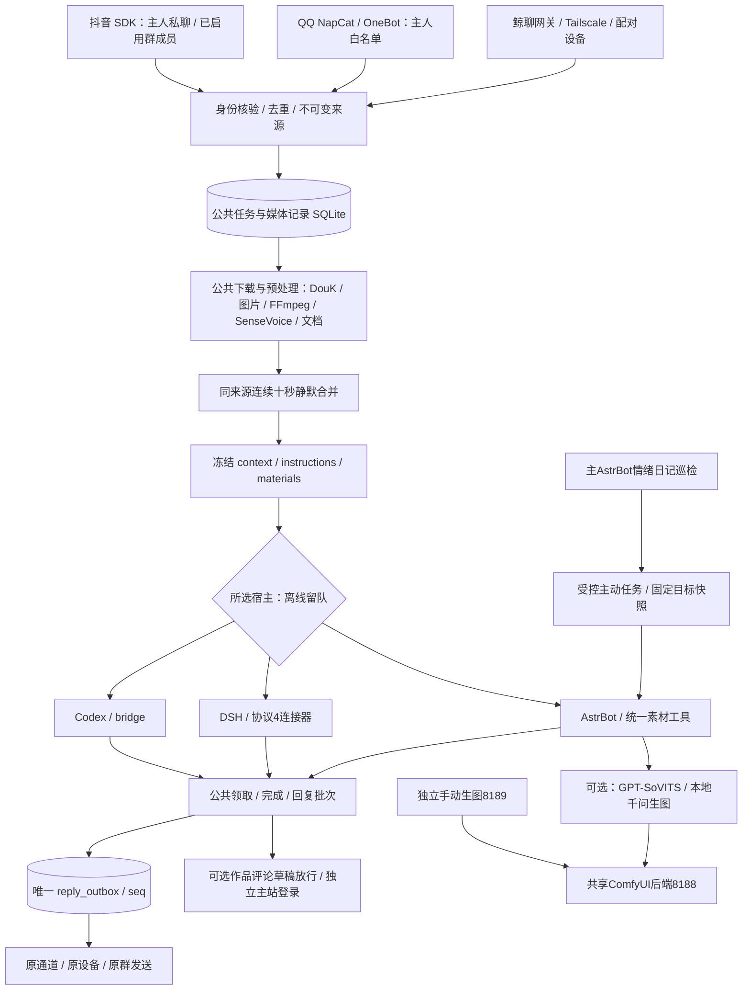

# 工作流架构审查与优化（2026-10-29）

## 当前架构

管理台8793管理SDK8791、接收器、鲸聊8795等轻量服务。QQ8796与WebUI6099仅回环；主AstrBot6185维护原生上下文。独立6186本地模型实例与工作流分离，只共享可选模型后端。手动生图不经过智能体或私信队列。媒体与凭据均在运行目录，公开仓库只放代码、模板、测试和部署说明。

## 本轮发现与修正

1. 监测误把SDK当作所有发送的依赖。改为根据未发送任务真实来源逐通道检查；混合队列只标记失败通道，正常通道继续，空队列检查实际主动目的通道。
2. 尚无平台回执的QQ/鲸聊待发记录会被显示成抖音。统一用channels.address读取任务地址，避免错误分类和历史反馈推断串通道。
3. 评论诊断若保存为非对象JSON，健康快照可能崩溃。现在忽略无效诊断结构，保留业务状态。
4. 现行AGENTS与统一协议积累重复的“待加载/已加载”记录。历史归档，现行规则只保留当前约束；删除旧十五轮、旧主动调度和Gemma仍在工作流中的歧义。

这些调整不改变用户模型、人设、会话、配对、额度、登录或来源地址，不添加模型调用。健康探测只读取数据和本机状态，不发业务消息。

## 保留的边界与后续方向

公共程序已经覆盖预处理、资料包、状态事务和出站，不宜为三个宿主再复制一套业务逻辑。暂不为规模较小的本地队列引入Redis或消息中间件，避免增加部署服务。SQLite持续作为事实来源，attempted先落盘与未知不重发保持。

平台提交成功不能证明接收端收到；群与私聊虽然使用同一原生宿主会话，仍依赖身份标记和规则避免信息泄露。插件市场升级可能覆盖本地补丁，应按安装器和隔离测试重新核验。服务端更新不自动等于手机APK更新。

## 验证与部署

新增隔离检查覆盖QQ/鲸聊不依赖SDK、混合队列单通道失败、未知地址、空队列目的通道、待发记录来源及只读数据库不变。完整测试结果见本轮备份目录。没有真实模型调用、对外试发或旧任务重放。本轮管理台源码需要经使用者安排正常重启后加载；GitHub提交与生产加载分别报告。
