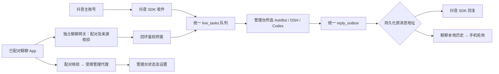

# 肥鱼助手：鲸聊通道与手机管理

2026-10-25。基于用户本地 `dsh-wechat-chat` 1.7.1 改造；并非腾讯微信适配器。

## 使用

1. 启动管理台即可，管理台自动保活独立鲸聊网关（回环8795），无需启动 DSH。
2. 手机覆盖安装本目录 `肥鱼助手-1.5.2.apk`。包名 `com.dsh.wechat` 保持，versionCode 12，签名与旧版相同；保留手机原配对数据；已配对手机通常无需重新扫码；新手机使用管理台“打开鲸聊配对面板”的当前 Tailscale 二维码，旧 Cloudflare 地址已停用。
3. 扫码后如启用公网密码，先在页面输入电脑端密码；配对成功会由网关自动登记到助手通道并跳回聊天页，不再需要去电脑管理台点“同步新配对设备”。如果仍停在引导页，先在电脑刷新配对面板出新二维码，再查看运行目录 `whale-service.log` 中 `pair accept` 与 `device auto-enroll failed` 两行。
4. 向助手发送一条文字，查看管理台任务及手机收到的回复。此步骤才是真实收发验收。
5. 聊天页右上角“管理台”进入手机管理，页面顶部“返回聊天”返回；首次进入管理台若提示设备未授权，说明配对登记没有完成，重新扫码或刷新新二维码。
6. 电脑管理台“会话投递 → 私信通道”可切换主动消息的目的通道及鲸聊设备。真正收到的私聊及随后生成图片仍回到原设备。

初次部署只登记原插件中当前有效的已配对设备，最多沿用原插件四台设备。新扫码配对成功后网关会通过回环桥接密钥自动登记设备；电脑管理台的“同步新配对设备”仍保留，用于补登记或恢复旧配对。手机不能为其他设备授权。暂停鲸聊时消息留队，不回退到 DSH 原聊天流程。

## 流程与边界

- 现有素材、数据库、工具、任务资料路径不迁移。新增状态仍在运行目录。
- 当前接收文字及插件已有的语音转写；返回文字分条和实际图片，作品卡在鲸聊转换为真实作品链接。没有新增手机图片/视频上传入口，也没有系统级后台推送。鲸聊音频回复见下方新增说明；抖音原生语音仍未接入。
- 语音使用本项目 tools/sensevoice 的独立 SenseVoice，由 app/whale_speech.py 调用，不读取 DSH 模型、服务或会话。转写完成后进入统一队列。
- 普通收到的新消息使主动发送通道跟随来源；管理员也可手动选择。主动消息入发送队列时固定地址，之后切换不重定向旧队列。
- 同一条媒体及文字只在同通道、同设备之间关联，保留原十秒关联期。抖音暂时离线不阻塞鲸聊收发。
- 鲸聊回执仅表示已写入电脑本地历史，不代表手机看过；稳定消息 ID 保证重连展示去重。结果不明不重新投递模型或重复外发。
- 手机管理仅开放精确允许的接口：状态、会话/主体/主动通道、活动与回复设置。登录、密钥、文件改动/清理、进程退出、设备授权及 AstrBot 管理 UI 不通过该代理开放。
- 原公网密码、一次性配对、设备有效期继续生效；传给管理台的是设备 SHA256 标识及独立本地桥接密钥，原手机设备 Cookie 不交给模型。独立网关自己管理公网隧道及配对，不使用 DSH 进程、插件、账号或安装目录；DSH 只在被选为 AI 处理主体时需要运行。
- 鲸聊历史里的图片依然引用本地文件，清理模块保护这些引用。手机隐藏消息不会自动删除本地历史或图片。

## 维护

- 核心：`app/channels.py`、`app/whale_channel.py`。
- 源码桥接：`integrations/whale_assistant_bridge.mjs`。
- 原 DSH 桥接安装脚本已停用，独立模式下会拒绝执行，避免误启第二条收信链路。独立网关源代码位于 integrations/whale_gateway，来源为用户 MIT 插件（保留 LICENSE）；开发用 extract_whale_standalone.py 可重建源码，正式运行不读取原插件。
- DSH 桌面 profile 的旧 dsh-wechat-chat bundle 已停用，原插件文件保留，不作为运行依赖。独立服务由管理台启动与正常关闭，health 验证服务身份，不为探测生成消息。
- 安卓源码仍在 `__DSH_HOME__\wechat-chat\app`。本次更改应用名、版本和 launcher 资源，图标采用用户第三张照片；未调用图像生成模型。
- 构建日志、缓存、中间产物：运行目录 `whale-android`；已用原有工具链构建并验证 APK。JDK 17 的 AF_UNIX 回环连接在此机器出错，构建进程使用不可用的 unixdomain 子目录，让 JDK 自身回退 TCP；不修改系统网络设置。
- 配置：运行目录 `whale-channel.json`；独立桥接密钥：`whale-bridge-secret.txt`，不输出、不加入提示词。

## 验证状态

源码与安装包已完成，隔离验证覆盖设备鉴权、重复入队、同 ID 冲突、跨设备隔离、旧消息地址保持、主动地址快照、SDK 离线隔离、图片散列、管理操作白名单和 HTTP 拒绝退出。完整项目测试、前端行为检查及原插件配对/语音/消息过滤测试见运行目录测试记录。

**独立生产服务已加载，手机真实收发仍待用户验收。** 管理台保活独立网关8795，已配对设备的工作流state、管理页面及概览代理均通过。已在DSH完全退出时验证，网关与AstrBot/抖音SDK保持在线。原DSH通道bundle已停用，不需再注册。398项Python测试中397通过、1跳过，UI14项和Node独立服务测试通过。用户选择稍后安装测试，不声称手机已收到新消息。

### 扫码跳转修复（2026-10-25 13:00）

实际现象是：新设备扫码/配对已成功，网关日志也出现 `pair accept OK` 和 `/wechat served ... device=...`，但聊天页随后请求 `/api/wechat/state` 失败，前端回落到“连接电脑上的鲸聊”引导页；点“管理台”则显示 `Remote management denied`。根因不是 APK 页面代码，而是新设备只写入了网关 `whale-data/whale-devices.json`，没有同步到 `whale-channel.json` 的已登记设备列表，控制台因此拒绝该设备的 state/管理和消息桥接。

修复：配对成功后 `core.mjs` 立即通过回环 `assistantBridge.enroll()`，用 `X-Whale-Bridge` 密钥调用本机 `/api/whale-bridge/enroll` 登记设备哈希；控制台新增只接受桥接密钥的登记入口，仍不做远程设备授权。已用真实配对流程验证自动登记，并同步当前已配对设备；修复后 `/api/wechat/state` 返回 `paired:true`，手机管理页返回 200 且 `/api/overview`、`/api/channels`、`/api/tasks` 代理正常。APK 1.5.0 无需重建，继续使用网关 `/wechat` 与移动管理代理页面。

引导页只有一套主流程：手机首次启动用 APK 内置 `firstrun.html`；已配对页面默认隐藏网关里的未配对引导，避免扫码后先闪一下“连接电脑上的鲸聊”。网关引导仅作为桌面浏览器直连或配对状态异常时的兜底，不建议删除，否则直连 `/wechat` 没有可操作入口。

旧二维码指向旧 Cloudflare 地址时仍会失效；必须从配对面板重新生成。若手机用系统相机扫码而不是 App 内“扫一扫连接”，系统可能打开浏览器；当前不声明系统级 App Links 支持，先使用 App 内扫码。

## 独立化实测（2026-10-25 12:12）

此前版本确实依赖 DSH，现已纠正并加载：管理台16356，独立网关28856、端口8795，系统 Node 启动。已通过应用正常退出菜单关闭 DSH，确认 DSH 进程消失后，网关 PID 不变、手机配对鉴权state为workflow=true、管理页面与概览代理200、本地SenseVoice就绪、抖音SDK与AstrBot在线；随后恢复原DSH窗口，网关仍为同一进程。独立公网隧道connected/published均为true。没有伪造主人消息做生产验收；用户仍计划稍后安装测试。

配对/昵称/头像/公网密码的当前数据已一次性复制至运行目录 whale-data，原DSH文件保留。业务素材、任务库和AI配置不迁移。独立隧道工具在 tools/whale，语音使用 tools/sensevoice；删除DSH安装也不影响该通道程序自身。关闭管理台时先经鉴权shutdown让网关释放自己创建的隧道，再结束自己的子进程。

新增独立服务启动/鉴权/关闭测试与本地语音测试；全量388项：387通过、1跳过，前端14项通过。检查记录：research/whale/dsh-off-readiness.json。旧段落中的DSH注册/重启记载仅是接入历史，不再是当前运行要求。

## 鲸聊语音回复（2026-10-25 新增）

AstrBot可调用新工具`whale_speak`，用本机中文女声生成真实语音；无需安装额外模型或申请Key。原有语音插件产出的record附件也支持。工具每轮一次，1–400字；附件10MiB/120秒以内，统一保存为16k单声道PCM WAV。电脑当前使用Microsoft Huihui Desktop，未来可配置其他TTS插件的音色。

流程：真实语音附件 → 本地鉴权下载/解码 → reply_outbox(audio) → 来源设备的鲸聊历史 → App语音播放控件。文字、图片、语音可混排，顺序固定、稳定ID去重；点击播放，不自动外放。本机工具生成的文字可展开查看，外部插件没有转写时不捏造。

音频在运行目录outgoing-audio；管理台资源路径页面可查看，清理保护待发及历史引用。普通抖音消息不获得鲸聊语音工具许可，不能通过抖音SDK误发。无需另一个APK，1.5.0 WebView直接使用网关更新的页面。用户之后安装、重新配对后可以发“用语音跟我打个招呼”验收。当前只有本地真实合成和隔离链路验证，不代表手机已收到/播放。

加载核验：已按此前授权正常重启管理台，当前管理台PID21408、独立网关PID21248。ping返回whale_audio_version=1，实际网关聊天页已含语音播放控件；鲸聊启用、AstrBot/抖音SDK在线，投递主体仍为AstrBot。插件工具whale_speak已通过官方工具列表核验启用。未向生产队列制造测试消息，没有声称手机收到；记录见运行目录research/whale/voice-readiness.json。

## 连接方式纠正：恢复Tailscale（2026-10-25，当前状态）

用户原有新版插件已使用Tailscale Funnel。独立化时错误地默认启用了Cloudflare，且抽取源码遗漏funnelArgs辅助函数，导致没有继承这项连接设置。本次已补回辅助函数、显式保存network.mode=tailscale_funnel，并将独立启动器默认改为Tailscale。autoTunnel固定false，无Cloudflare回退。测试可显式使用disabled，避免在隔离测试中启动外部网络。

独立网关已经正常关闭旧实例并由管理台保活重启：PID14152，health.network=tailscale_funnel；接口明确返回autoTunnel=false、Cloudflare phase=stopped。配对页说明已改为Tailscale。Funnel仍只指向带原密码/配对验证和白名单的本地安全网关，不把管理台或DSH整个服务公开。

**当前公网未恢复。** 系统Tailscale服务虽为Running、保存的账号仍在且WantRunning=true，但后端持续NoState，Health提示starting。普通up因需保留自定义hostname而第一次拒绝，随后从现有prefs读取hostname并原值带入up，命令返回0，后端仍NoState。未使用reset、未注销、未改变hostname/账号/其他网络设置。当前权限尝试正常Restart-Service被系统拒绝，无法在本会话完成系统服务重启。恢复Tailscale系统服务后，网关每15秒检查并自动重连；不自动回退Cloudflare。手机实际连接仍需后续验收。

397项Python测试：396通过、1跳过；14项UI检查、4项Node测试通过，覆盖Tailscale默认配置、拒绝Cloudflare模式、禁用测试网络、固定地址校验及Funnel端口参数校验。日志在运行目录tests/whale-tailscale-full.log。源码备份在backups/whale-tailscale-20261025。旧段落的Cloudflare已连接仅是历史状态。

### Tailscale后续复核：已恢复（2026-10-25，覆盖前述未恢复状态）

用户启动Tailscale客户端后，系统返回Running/Online、Health无错误。又发现上游CLI输出只保留末8KB，而实际status JSON约30KB，导致JSON解析失败；现已改为最多2MiB完整读取，超限报错，stderr与JSON分开，不再截断后当正常JSON。新增大JSON/超限回归测试。

网关已正常重启并自动接通Tailscale Funnel：autoTunnel=false、funnel.enabled=true，固定地址https://example.tailnet.ts.net。实际HTTPS /wechat返回200密码验证页，非白名单/health返回404。Cloudflare未运行，不依赖DSH；未生成测试主人消息，不声称手机收发或音频播放已验收。397项Python测试396通过1跳过、14项UI、5项Node测试通过。核验记录：运行目录research/whale/tailscale-readiness.json。

## 手机界面与加载优化（2026-10-25）

无需新版APK，重新打开聊天页面一次即可载入。管理台图标在左上，扫码在右上，昵称在中央。管理面板保留聊天DOM和滚动位置，返回不重新拉取整段历史。设备列表显示系统/机型、最近活跃时间，可备注名称；手机管理时标记“本机”。

长按气泡可复制、选择部分文字或多选消息；滑动取消长按，点击头像独立打开外观菜单。主人/助手语音使用同一种轻量气泡，点击播放、再点停止，文字单独展开。图片可点击预览。管理页并行/按需请求、选项卡保留DOM、头像与媒体私有缓存，写设置会使读取缓存失效。保留DSH的自动登记和Tailscale连接，不重配对、不改变模型人设。

## 当前安装包：1.5.1（2026-10-25）

覆盖安装本目录`肥鱼助手-1.5.1.apk`，无需卸载旧版。包名com.dsh.wechat、原签名保持，versionCode11；图标替换为用户本次提供的蓝发人物图（icon-source.png）。已核对APK包含的5种分辨率图标与签名。成功加载页面时flush配对Cookie，保留既有origin/client_id/头像与设置；没有增加权限。

管理台一个手机选项可包含多次扫码留下的历史配对；折叠仅影响显示，不混合消息权限/历史。有效Cookie重复扫码复用原配对，无凭据时不能只凭相同机型恢复旧身份。

语音可接GPT-SoVITS及翻唱插件的真实Record，最长10分钟/32MiB（仍统一16k单声道WAV）。后台翻唱完成后通过有效原任务许可持久入队；过期不补发。当前只安装插件，没有模型后端，须另行部署才能使用角色音色或翻唱。系统女声仍为备用；管理台会显示实际状态。

本机已有工具链构建命令：在原Android源码__DSH_HOME__/wechat-chat/app运行Gradle8.14.2的assembleDebug --no-daemon --offline，使用运行目录whale-android的project-cache/gradle-home/build-paths.gradle，JDK17及TCP回退参数沿用原环境；没有新安装系统依赖。新旧包均沿用原debug签名方式。

## 手机文件上传（1.5.2）

聊天输入栏点击“＋”→“选择图片”或“选择文件”→确认列表→“上传并发送”。一次最多6个，图片单个10MiB、其他文件单个32MiB。上传进度及失败原因直接显示；失败保留本轮文件和编号，手动重试同一编号不会重复建任务，刷新页面后重新选择则视为新上传。

APK 使用 Android 系统文件选择器（ACTION_OPEN_DOCUMENT），仅取得主动选中文件的读取权限，不扫描手机目录、不申请新的全盘存储权限。沿用原包名、图标和签名，可覆盖安装保留配对与聊天；签名证书已对比1.5.1一致。

图片复用入站格式校验和看图流程；视频抽帧、音频复用本地SenseVoice；TXT/Markdown/CSV/JSON等文本、可提取文字的PDF和DOCX生成文本资料。其他文件仍保存，但明确标记未自动解析，AstrBot不能凭文件名声称读懂。扫描PDF本轮不做OCR。文件、文件内指令均不是运行权限。

网关先鉴权，再将二进制暂存到运行目录whale-data/uploads/<设备散列>/<上传编号>.upload；桥接仅传递小JSON和散列，本地校验后落到管理台配置资源根的media/<任务ID>/，不改变既有路径设置。确认接收后清除暂存；连接结果不明保留供同编号重试，单设备暂存总量128MiB。设备不能读取其他设备的附件。

附件进入media_pending → 校验/解析 → resource_saved；至少10秒关联同设备后续文字，否则独立投递管理台所选AstrBot/DSH/Codex，回复仍回原设备。鲸聊历史引用的附件不进入定期清理候选；不会因任务完成而留下失效预览。

验证：Android Java编译及APK打包通过，版本1.5.2/code12；隔离图片/文档/关联等待/跨设备/重复上传测试、HTTP桥接测试、全Python回归通过。真实手机系统文件选择及端到端上传仍需覆盖安装后验收，不能用编译结果代替手机验收。

Android正式入口源码快照见android-source/MainActivity.java及app.build.gradle，完整原项目位于__DSH_HOME__\wechat-chat\app。构建缓存和日志位于运行目录whale-android，不放项目主目录。

## 断线恢复（1.5.3，2026-10-27）

新版不因临时DNS/TCP错误删除服务器地址或配对，提供有限重试、手动重试及回前台恢复。直接覆盖安装肥鱼助手-1.5.3.apk（code13、原签名），无需卸载。服务端增加请求超时、串行重连和真实公网TLS探测；后台改动需正常重启加载，APP改动需安装新APK。电脑本地可访问不代表Funnel公网可访问；公网TLS故障与配对失效分开排查，不为网络故障反复扫码。

加载更新：2026-10-27经主人批准已重启加载服务器端重连及公网探测；真实两个公网入口HTTP 200。手机端原生恢复需覆盖安装1.5.3。
